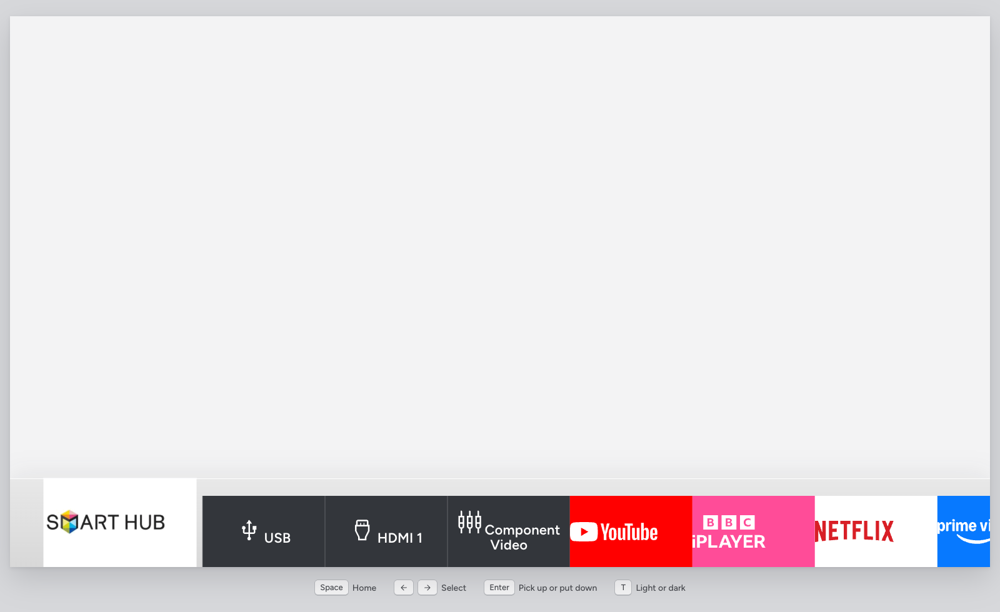
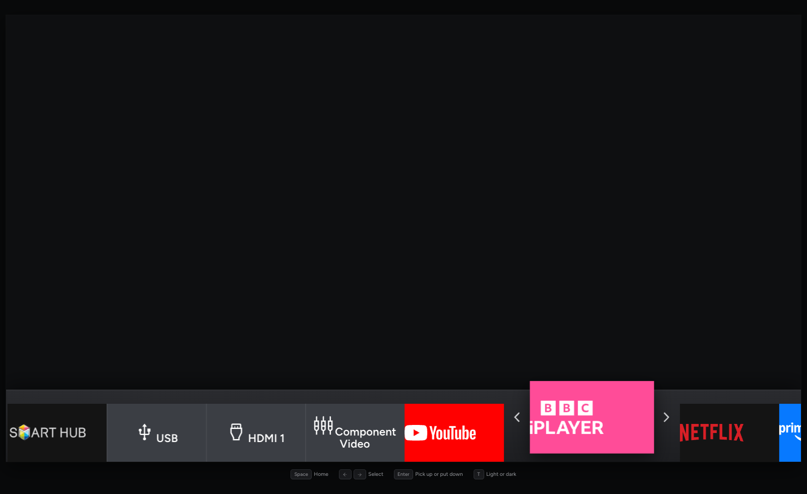
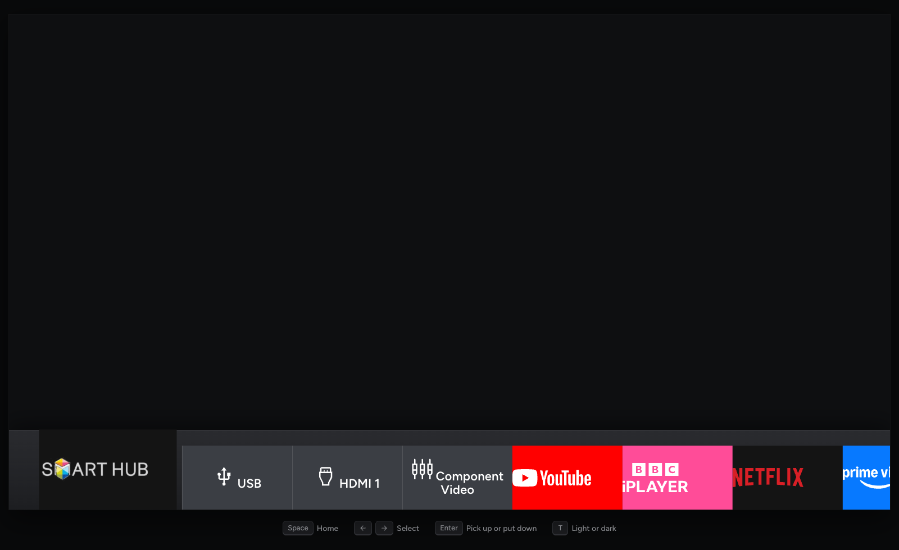
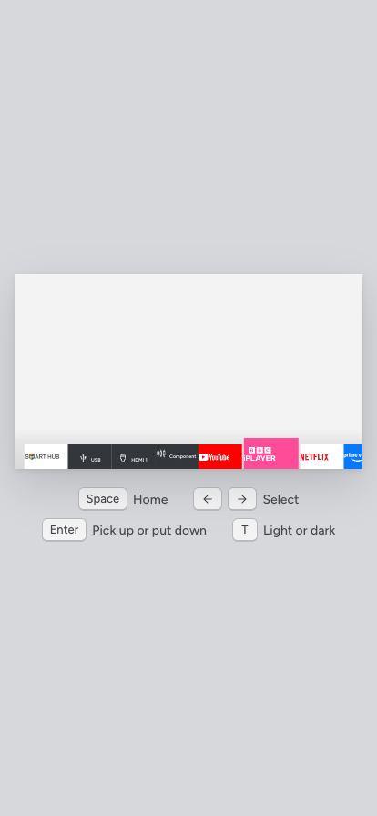

# TV Launcher

An interactive mockup of a smart TV home screen, styled after Samsung's Tizen 3 Smart Hub bar but simpler, aimed at running on something as modest as a Raspberry Pi 3. Plain HTML, CSS and JavaScript — no build step, no framework.



## Try it

```
git clone https://github.com/LBSiUK/tv-launcher.git
cd tv-launcher
python3 -m http.server 8080
```

Open `http://localhost:8080` and use the keyboard:

| Key | Does |
|---|---|
| `Space` | Show or hide the home bar |
| `←` `→` | Move along the bar |
| `Enter` | Pick up the focused tile, or put it down |
| `T` | Switch light and dark mode |

## What it does

- A fixed 16:9 TV frame with a bar of tiles along the bottom: Smart Hub, USB, HDMI 1, Component Video, YouTube, BBC iPlayer, Netflix, Prime Video and Web Browser.
- The focused tile grows to fill the bar; its neighbours step aside.
- Pick a tile up with `Enter` and carry it to a new spot with the arrow keys — the rest of the bar slides out of the way, and chevrons show which way it can still move.

  

- More tiles than fit on screen: the bar scrolls sideways to keep the selected tile in view, always leaving a peek of the next one.
- Light and dark mode, matched to Tizen's own light bar and a new dark one. It starts in the system's mode; `T` overrides it for the session.

  

- Works down to phone width too.

  

## Why

Tizen 3's real Smart Hub has a row of discovery content (Shazam, recent, featured) above the app bar. This mockup leaves that out and keeps just the bar — simpler, and light enough to animate smoothly on low-powered hardware. Every moving part is a CSS `transform`; nothing here needs a GPU to be worth having.

## Notes

- This is a UI design exercise, not a working launcher — none of the tiles open anything yet.
- The tile order resets on reload; it isn't saved anywhere.
- Service logos are the brands' own marks, used here for a mockup only.
